### UIII Act4 Importación y descripción de datos con Pandas ML.md
## Jesus Arriaga NC 0019
## Consultas de laboratorio 
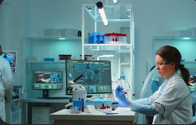
## TABLA ORIGINAL DE CONSULTAS DE LABORATORIO 
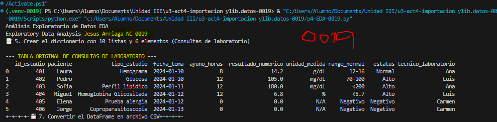
## Convertir el DataFrame en archivo CSV
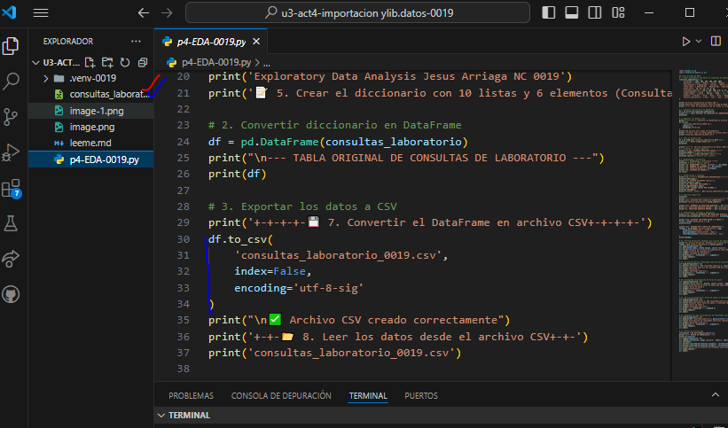
## Datos del cvs --> base de datos
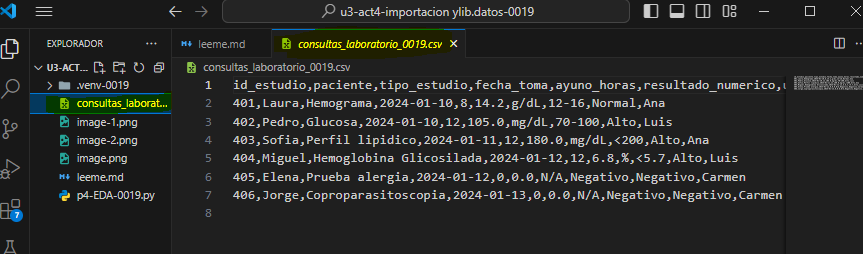
## Leer los datos desde el archivo CSV
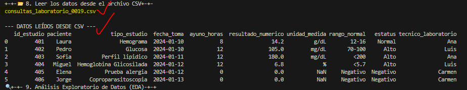
## Análisis Exploratorio de Datos (EDA)
## Primeros y últimos registros
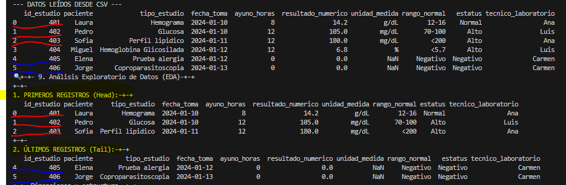
## Dimensiones y estructura
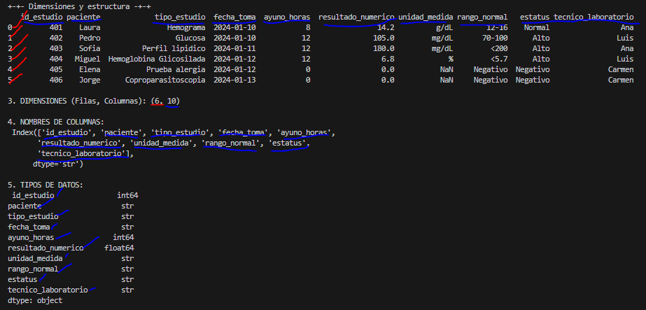
## Estadisticas y limpieza
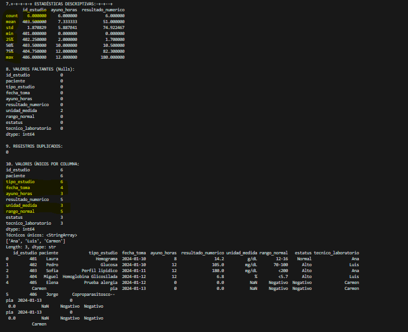
## Gráfica de barras: Estudios por técnico de laboratorio
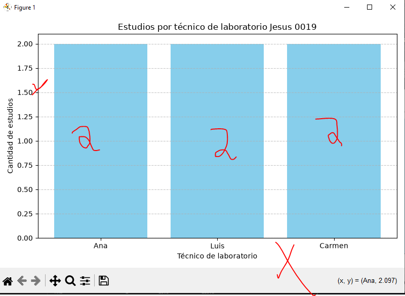
## Gráfica de barras: Resultado numérico por paciente
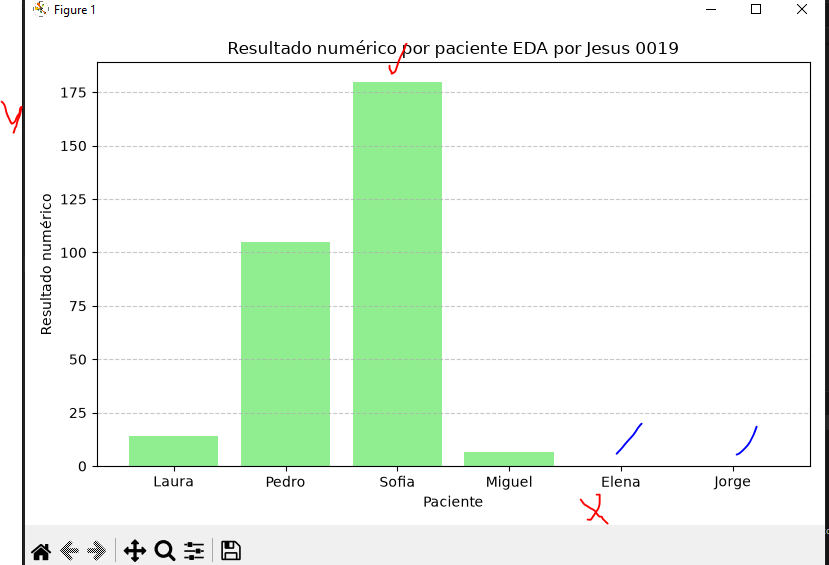
## Histograma: Distribución de horas de ayuno
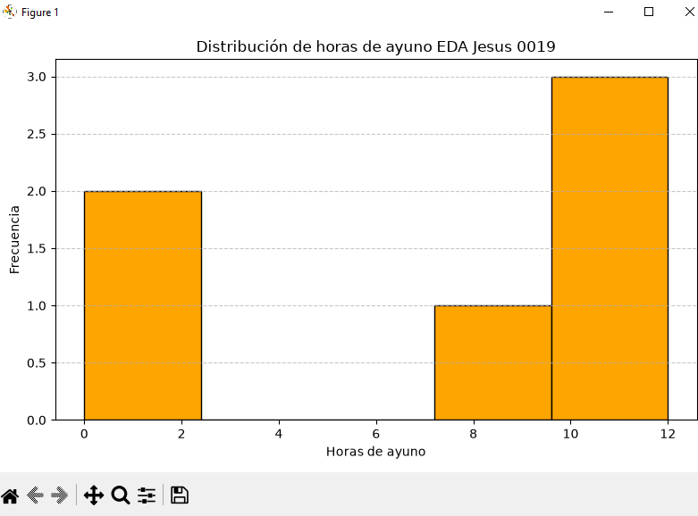
## Gráfica de dispersión: Horas de ayuno vs Resultado numérico
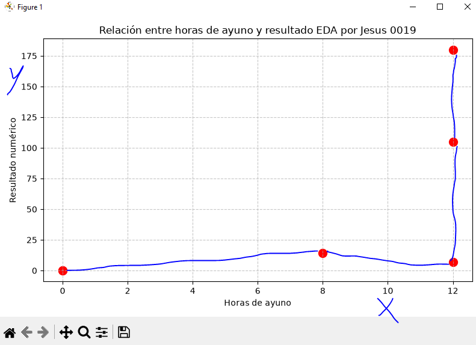
## Diagrama de caja: Distribución de resultados numéricos
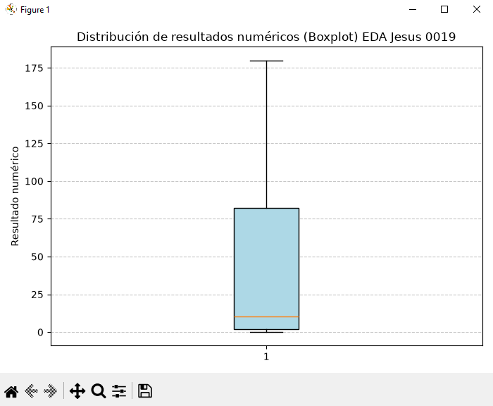
## Diagrama de caja: Distribución de resultados numéricos
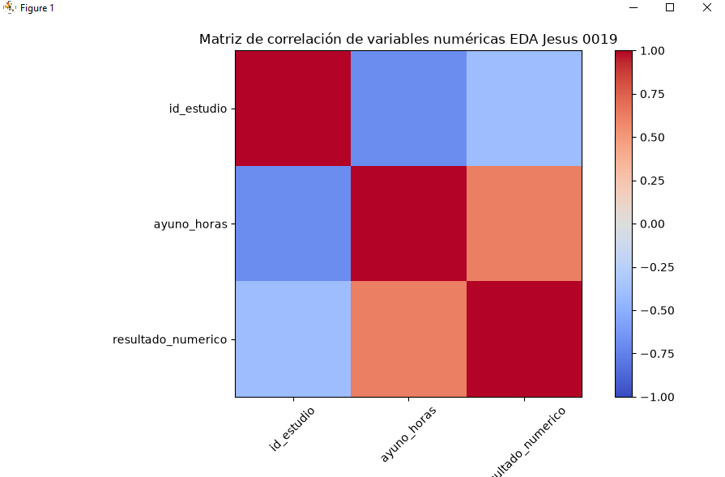